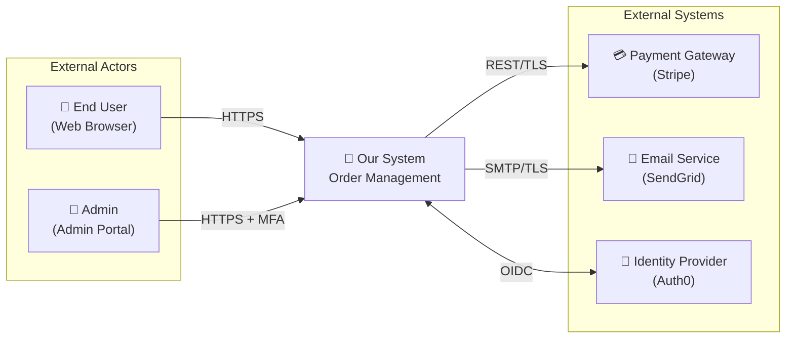
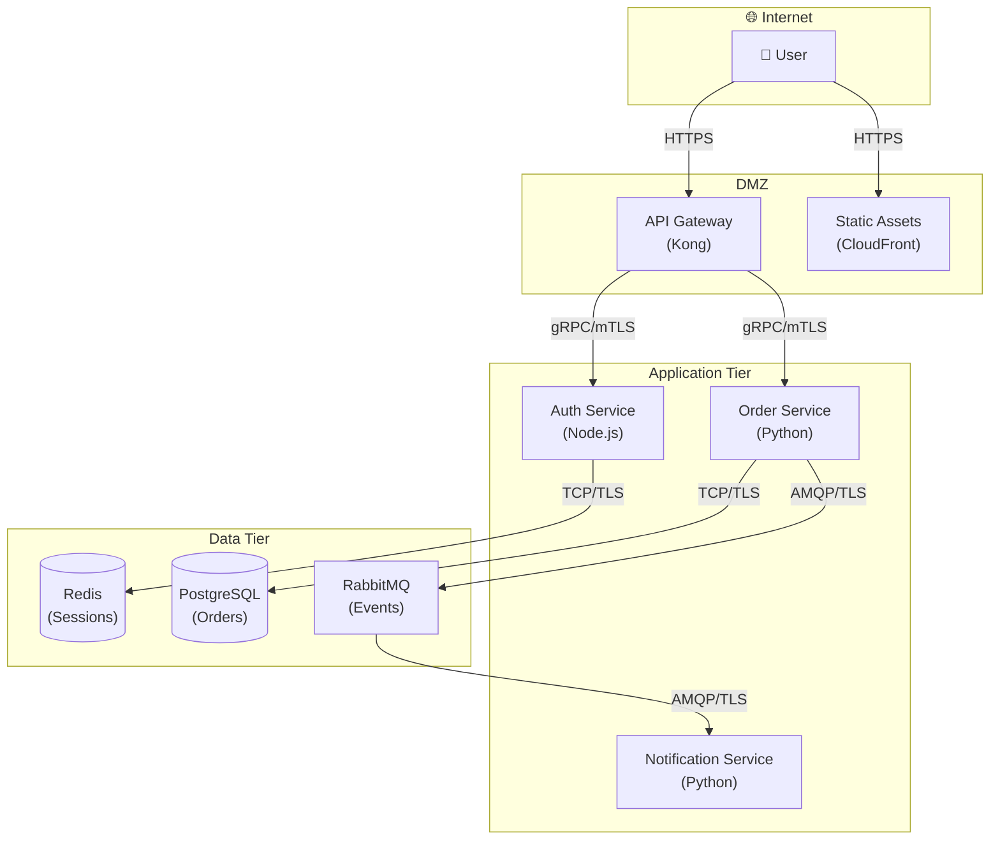
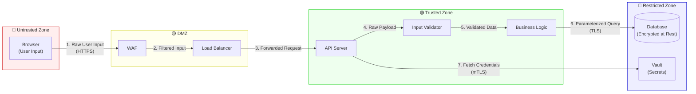
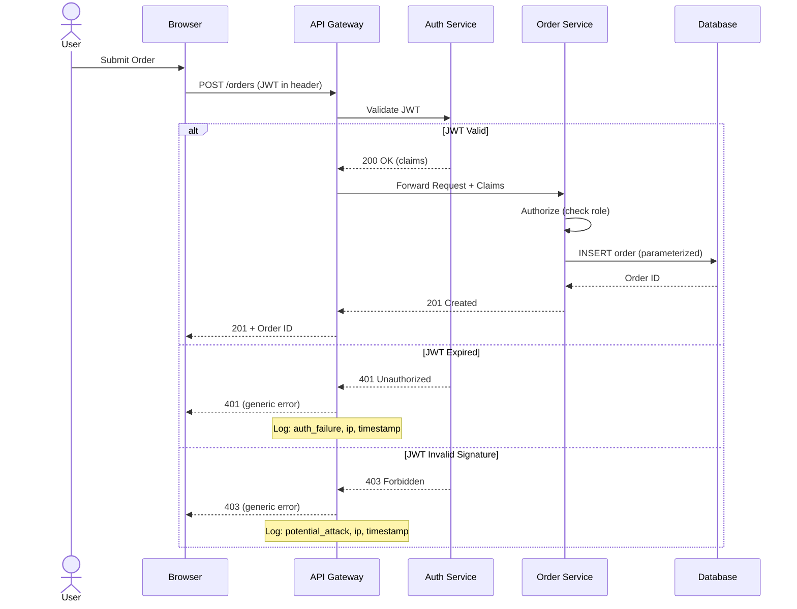
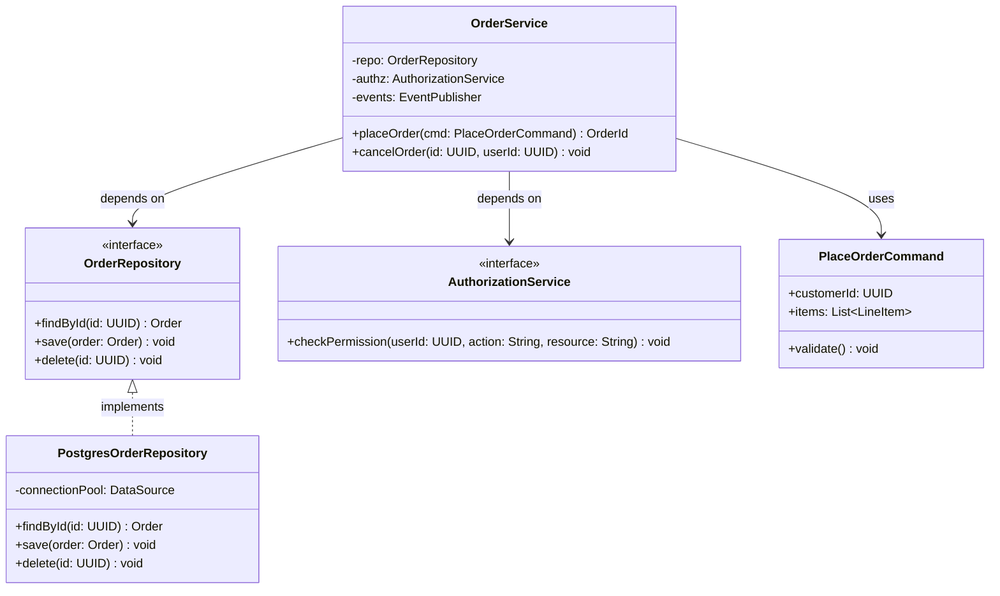
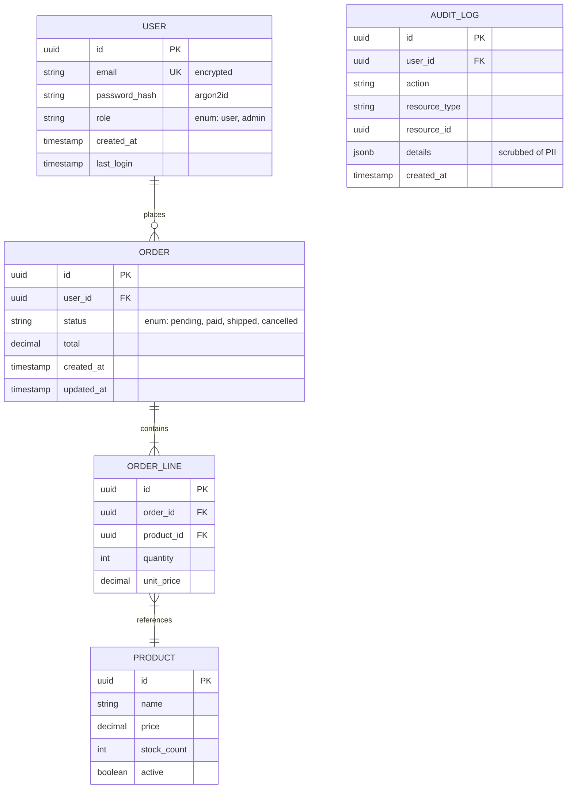
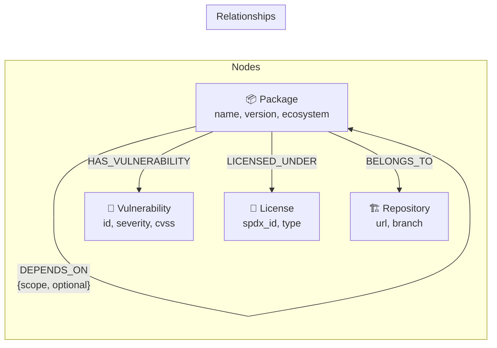
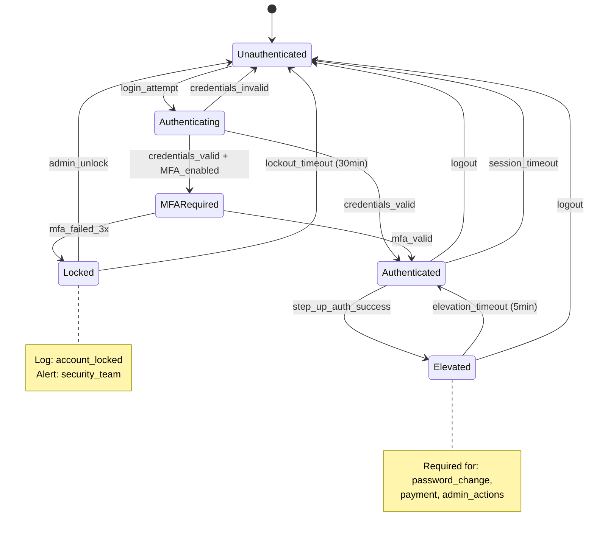
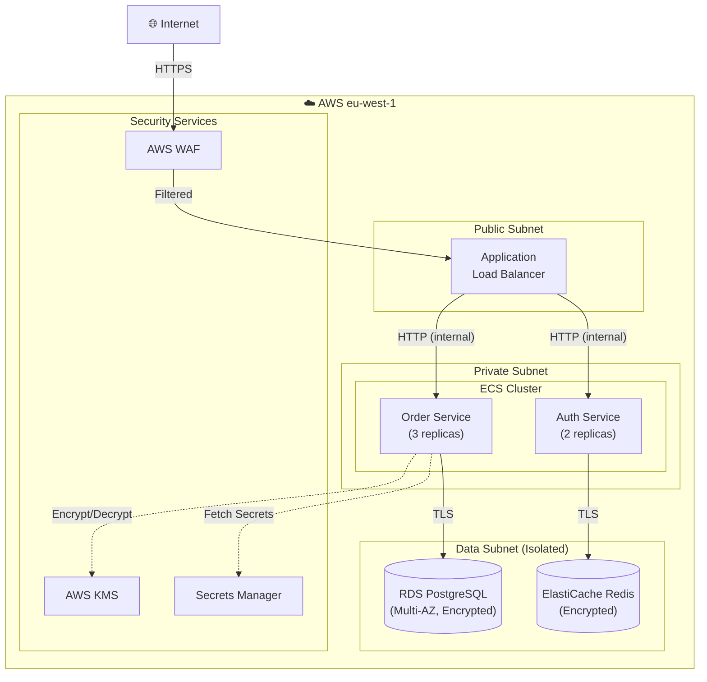

<!-- SPDX-License-Identifier: Apache-2.0 -->
<!-- Copyright 2026 Brett Crawley -->

# Diagram Generation — Templates and Guidance

## Table of Contents
1. [System Context Diagram](#system-context-diagram)
2. [Container / Component Diagram](#container-component-diagram)
3. [Data Flow Diagram with Trust Zones](#data-flow-diagram)
4. [Sequence Diagram](#sequence-diagram)
5. [Class Diagram](#class-diagram)
6. [Entity-Relationship Diagram](#entity-relationship-diagram)
7. [State Machine Diagram](#state-machine-diagram)
8. [Deployment Diagram](#deployment-diagram)
9. [Diagram Selection Guide](#diagram-selection-guide)

---

## System Context Diagram

Shows the system as a single box with its external actors and systems. C4 Level 1.

Use when: Starting any new design. Establishing scope and external dependencies.

**Rules**:
- One box for the system under design — don't decompose it yet
- Show all external actors (human and system)
- Label all connections with protocol and security mechanism
- Mark which connections cross the internet vs internal network

---

## Container / Component Diagram

Shows the internal structure of the system. C4 Levels 2-3.

Use when: Decomposing the system into deployable units (containers) or logical components.

**Rules**:
- Group by deployment zone / trust boundary
- Label each container with its technology stack
- Show all communication paths with protocol
- Distinguish synchronous (solid lines) from asynchronous (dashed lines) communication

---

## Data Flow Diagram with Trust Zones

Shows how data moves through the system, with explicit trust boundaries.

Use when: Analyzing data flows for threat modeling input. Identifying where data crosses trust boundaries.

**Rules**:
- Color-code trust zones (red = untrusted, yellow = semi-trusted, green = trusted, blue = restricted)
- Number the data flows to show sequence
- Label what data moves at each step (not just "request" — "raw user input", "validated order data", "encrypted PII")
- Mark trust boundary crossings explicitly — this is where threats concentrate
- Show where encryption, validation, and authentication occur

---

## Sequence Diagram

Shows the interaction between components over time.

Use when: Detailing auth flows, multi-service interactions, error handling sequences.

**Rules**:
- Include error paths and security-relevant branches (auth failure, validation failure)
- Show where logging/auditing occurs with Notes
- Use `alt` blocks to show different outcomes
- Never show sensitive data in the diagram (tokens, passwords) — use labels like "JWT" or "credentials"

---

## Class Diagram

Shows class structure, interfaces, and relationships.

Use when: Detailing OO design, showing pattern implementations, documenting interfaces.

**Rules**:
- Show interfaces and their implementations (demonstrates DIP)
- Mark dependencies with direction arrows (who depends on whom)
- Include authorization and security services as explicit dependencies
- Use stereotypes (`<<interface>>`, `<<abstract>>`, `<<entity>>`) for clarity

---

## Entity-Relationship Diagram

Shows data model structure and relationships.

Use when: Designing database schemas, documenting data models.

**Rules**:
- Annotate sensitive fields with their protection mechanism (encrypted, hashed, scrubbed)
- Include audit tables — they're part of the data model
- Show cardinality explicitly (||, |{, o{)
- Use enums for status fields — document valid values
- Include indexes on fields used in queries and foreign key relationships

### Graph ER Diagram (for Graph Databases)

For graph databases, model as nodes and relationships:

---

## State Machine Diagram

Shows lifecycle states and transitions.

Use when: Modeling session lifecycle, order status, user account states, workflow states.

**Rules**:
- Include security-relevant states (Locked, Elevated, MFARequired)
- Show timeout transitions (sessions expire, lockouts expire)
- Annotate states with logging/alerting requirements
- Model failure transitions (what happens on authentication failure, exceeded attempts)

---

## Deployment Diagram

Shows infrastructure topology and deployment configuration.

Use when: Documenting how the system is deployed, network topology, infrastructure security.

**Rules**:
- Show network segmentation (public, private, isolated subnets)
- Mark encryption at each boundary
- Show replicas and high-availability configuration
- Include security services (WAF, KMS, Secrets Manager) as explicit infrastructure components
- Distinguish data flow (solid lines) from control/management flow (dashed lines)

---

## Diagram Selection Guide

| Question | Diagram Type |
|----------|-------------|
| What is the system and what does it talk to? | System Context |
| What's inside the system? | Container / Component |
| How does data flow and where are the trust boundaries? | Data Flow Diagram |
| What happens step-by-step in this interaction? | Sequence Diagram |
| What does the object model look like? | Class Diagram |
| What does the data model look like? | Entity-Relationship Diagram |
| What states can this entity be in? | State Machine |
| How is it deployed? | Deployment Diagram |

**For Design Mode**: Start with System Context → Container → Data Flow → Sequence (for key flows) → Class (for core domain) → ER (for data model).

**For Review Mode**: Start with whichever diagram reveals the biggest concern. Usually Data Flow (trust boundaries) or Container (coupling).

**For Advisory Mode**: Use the diagram that best answers the specific question. Usually one is enough.
