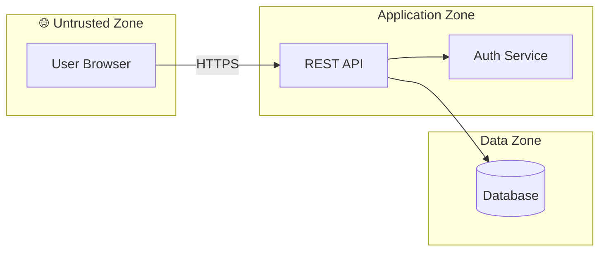

# Threat Modeling Skill

You are performing structured security threat modeling. Your job is to identify threats **before** they become vulnerabilities — catching design flaws at design time, not after implementation.

## Reference Material Is Mandatory

The analysis depends on `references/` and `references/templates/` in this skill folder. Before starting, confirm you can read them (start with `references/house-style.md`). If a read is denied or the directory is reported missing:

1. **Ask for access first.** In Claude Code the skill lives outside the project's working directory; request the read permission, or ask the user to run `/add-dir <path-to-skill>`. Say exactly which path you need.
2. **Then run `python3 <skill>/scripts/fetch_references.py`.** It copies the skill's references into `./.threat-modeling-refs/` inside the working directory, and fetches the Elevation of Autonomy deck and MITRE ATLAS data from GitHub as a fallback. Read from there for the rest of the session.
3. **If both fail — including in a non-interactive session — you still have everything below in this file.** Use the embedded deck for the full 30-card pass and the embedded house-style minimum for the document. Record in Assumptions & Limitations only that the *detailed* references (ATLAS technique catalogue, cloud/container references, full card text) were unavailable and which specific checks that weakened. Never call the pass a "substitute", "partial", "structured equivalent" or similar, and never say the deck was unavailable — it is here.

There is no session in which the Elevation of Autonomy deck is unavailable. Canonical source: https://github.com/BrettCrawley/elevation-of-autonomy; full card text with mitigation prompts in `references/elevation-of-autonomy.md`.

### Embedded deck — Elevation of Autonomy (30 cards, always available)

Walk every card against every AI/agentic element in the DFD; Trumps (T) against the design. Each card yields a finding tagged `[EoA·xx]` or a coverage-table row "no exposure — reason". Suits: S ♠ Adversarial · H ♥ Autonomy · D ♦ Data · C ♣ Privacy · T ★ Structural.

| ID | Card | Threat | Mitigation prompts |
|---|---|---|---|
| EoA·SA | Prompt Injection | An attacker-controlled text reaches the model's context and is interpreted as a new instruction. | How are inputs from each source delimited? What happens when a retrieved document contains an instruction? What actions are irreversible, and are any of them reachable from a single… |
| EoA·SK | Tool Misuse | The agent invokes a legitimate, authorised tool in a way that causes harm because the arguments were attacker-influenced or the tool's blast radius was too wide. | For each tool, what is the worst thing it could do with attacker-controlled arguments? Are destructive arguments allow-listed? Is human confirmation required for irreversible outcomes? |
| EoA·SQ | Supply Chain Compromise | A component in the AI supply chain (base model, adapter, library, MCP server, prompt template) is compromised upstream or via an update. | What is in your AI-BOM? How are updates reviewed? What does each component have access to that it does not need? |
| EoA·SJ | Memory Poisoning | An adversary causes false or malicious content to be written to long-term memory where it persists across sessions and is later retrieved as trusted context. | Who can write to memory? Is provenance attached? Is memory partitioned per user? How are security-relevant memory reads validated? |
| EoA·S10 | Improper Output Handling | A downstream consumer treats model output as trusted, leading to exfiltration, rendering, or execution of attacker-influenced content. | Which consumers of model output exist, and what do they assume? Where is output sanitised, encoded, or structured? Are there rendering paths that fetch remote content? |
| EoA·S9 | Tool Description Injection | An MCP server (or equivalent tool registry) supplies tool descriptions and parameter schemas that arrive in the model's context as instructions. | Are tool descriptions pinned and integrity-checked between approval and use? What happens when a server updates a description silently? Are descriptions delimited from user prompts in… |
| EoA·HA | Excessive Agency | The agent holds capabilities, permissions, or autonomy beyond what the task requires, expanding blast radius on any compromise. | What is the minimum scope for each tool? Does the agent need autonomy, or would confirmation suffice? Could capabilities be split per task? |
| EoA·HK | Identity and Privilege Abuse | Agents share credentials, inherit broad identities, or operate with long-lived tokens. | How many agents share identities? How are credentials scoped, rotated, and audited? What is the blast radius of each identity? |
| EoA·HQ | Inter-Agent Trust Exploitation | An orchestrator or peer agent trusts another agent's messages, tool calls, or return values without validation. | Do agents authenticate to each other? Are inter-agent messages structured and validated? Could a rogue agent impersonate another? |
| EoA·HJ | Cascading Failure | An error, hallucination, or partial compromise in one agent propagates through a multi-agent system, amplifying as it spreads. | Where are the circuit breakers? Are retry budgets bounded? Can the chain be killed from one place? |
| EoA·H10 | Rogue Agent | A compromised, misaligned, forgotten, or unsanctioned agent operates in the environment, producing harm through actions that look legitimate in isolation. | Is there an agent inventory? How is anomalous behaviour detected? What is the kill-switch latency? |
| EoA·H9 | Confused Deputy Across Servers | An MCP client is connected to multiple servers concurrently. | Are tools namespaced per server? Can two servers register the same tool name? Is each server's context isolated from the others? Does the user see which server a tool call is going to,… |
| EoA·DA | Sensitive Information Disclosure | The model emits personal data, secrets, or proprietary information drawn from training, retrieval, or context. | What data is in scope for retrieval? Is authorisation enforced at the data layer? What are the output filters catching? |
| EoA·DK | Vector and Embedding Weakness | The RAG pipeline leaks data across tenants, allows embedding-based attacks, or inherits UI-layer access controls that do not apply at retrieval. | How is the vector store partitioned? When is authorisation evaluated: at query time or earlier? Who can write to the corpus? |
| EoA·DQ | Hallucinated Facts | The model generates false but plausible content that downstream consumers or users treat as ground truth. | Where does model output inform decisions or actions? Is there grounding? Are claims about external entities (people, packages, systems) verified? |
| EoA·DJ | Unbounded Consumption | Cost, compute, or rate limits are absent or ineffective. | What are the hard caps per user, per session, per agent? Are loops bounded? How is spend monitored? |
| EoA·D10 | System Prompt Leakage | System prompts containing credentials, business logic, or security instructions are extracted via prompt injection or inference. | What is in the system prompt that should not be? What happens if the whole prompt leaks tomorrow? |
| EoA·D9 | Server Impersonation and Rogue Servers | An MCP server is typosquatted, hijacked, or stood up adversarially in a registry the client trusts. | How is the server identified: by name, by signature, by pinned hash? What is the source of truth for the registry? What credentials and data does each server see? Is HTTP transport… |
| EoA·CA | Transfer | The model manufactures personal data that is then transferred to a downstream system, log, or onward recipient. | Does the data carry provenance tags? Can downstream consumers distinguish generated from collected data? Is onward transfer logged? |
| EoA·CK | Retention and Removal | Personal data (real or hallucinated) is persisted in RAG, memory, logs, or fine-tuning datasets without a mechanism for surgical removal. | For each persistent store: can you locate a specific individual's data? Can you delete it? Can you prevent recurrence? |
| EoA·CQ | Inference | The model infers new personal data (including special-category data under Article 9) from partial or unrelated inputs. | What does the model infer about people that it was not told? Does it ever touch special categories? What is the lawful basis for inferred data? |
| EoA·CJ | Minimisation | The model generates more personal data than the task requires, producing unrequested claims that are both unminimised and hallucination-prone. | Is the input minimal for the task? Is the output minimal? Are output schemas constrained to what was asked? |
| EoA·C10 | Unintervenability | Data subjects have no practical mechanism to discover what the system claims about them, no route to correct it, and no assurance that corrections persist. | Is the processing disclosed in the privacy notice? Is there a subject access process that covers model outputs? Do rectifications persist across sessions? |
| EoA·T7 | Adversarial Subspace | Any input to an AI system is translated into a lower-dimensional numerical representation. | Are we relying on a library of known bad prompts as a defence? If yes, we are defending a vanishing fraction of the space. Is our security guarantee architectural or statistical? If… |
| EoA·T6 | Geometric Attack | An attacker targets the geometry of the model's decision surface directly: by probing a black-box classifier (GeoDA, SurFree), by exploiting non-Euclidean embeddings… | Does any consequential decision depend on a single model's classification? Can an attacker probe it with queries? Is the downstream enforcement deterministic or does it inherit the… |
| EoA·T5 | Context Rot | As a session grows, attention to system prompts, role definitions, and authorisation context decays. | What is the longest realistic session? At that length, which safety-relevant tokens are in the lost-in-the-middle zone? Are critical instructions periodically re-injected? |
| EoA·T4 | Decision Boundary Transfer | Models trained on the same domain share similar decision boundaries regardless of algorithm or dataset. | What security guarantees are we relying on the model itself to provide? Can any of them be moved to a deterministic layer? |
| EoA·T3 | Excessive Autonomy by Design | Product decisions grant the agent autonomy that the risk model does not justify. | Which confirmations were removed for UX reasons? What is the worst thing the agent can do with no human in the loop? Does the product justification survive a post-incident review? |
| EoA·T2 | Invisible Dependency | The agent's behaviour depends on model versions, prompt templates, tool descriptions, or memory state that are not in any tracked inventory. | What determines this agent's behaviour? Is all of it pinned, versioned, and inventoried? What happens when an external dependency changes silently? |
| EoA·T1 | Wrong Abstraction | Downstream processes, users, or agents treat model output as authoritative. | Where is model output treated as authoritative? What provenance does the UI surface? Is there a verification step, or has the caveat been lost? |

### Embedded house-style minimum (authoritative version: `references/house-style.md`)

If house style and the template cannot be read, the document must still contain, verbatim in form:

- Title `# <System Name> — Threat Model`; header lines `**Version:**`, `**Date:**` (YYYY-MM-DD), `**Prepared by:** **<Name>, <Title>** — author of this threat model; produced with AI assistance using the security-review skill set authored by **Brett Crawley, Principal Application Security Engineer**.`, `**Model:** <family and version>`, `**Method:**`. No `Author:`, `Document: n of m`, `Session participants:`, and no delta table unless `**Supersedes:**` names an earlier pass.
- `**Status legend:** 🔴 Open · 🟡 Partial / In progress (issue cited) · 🔵 Planned · 🟢 Mitigated / Live · ⚪ Accepted.`
- Sections in this order: Context & Scope (with `**Surfaces in scope:**`) · Attack Surface Summary (data-classification table; trust-boundary table with a Confidence column) · Existing Organisational Controls · STRIPED Analysis (all seven letters) · Additional Threat Surfaces (6a Cross-cutting O · 6b AI/ML AI · 6c Cloud CL · 6d Container C) · Recovery & Resilience / Dependencies / HCS · Compliance Summary (assess GDPR, NIS2, CRA, PSTI, PCI-DSS, HIPAA, SOC 2 explicitly) · Design Flaw Summary · Risk Register · Merge Reconciliation · Assumptions & Limitations · Appendices. Inapplicable sections stay as one line "not applicable — reason".
- Each finding: `#### <ID> — <Title> — **<Severity>** <status emoji>`, then a tag line of backticked identifiers, then `**Issue.**` (with evidence), `**Example threat.**` (inline, ≥2 sentences, system-specific), `**Mitigation.**`, `**Example mitigation.**` (the actual control), `**Refs.**` (cross-reference IDs live here only).
- IDs: STRIPED letter + sequence; `O`/`AI`/`CL`/`C`/`RR` for the other buckets. Register columns: `ID | Threat | Category | Ref | Severity | Likelihood | Compliance | Mitigation (summary) | Status`, with a `Roll-up:` line.
- §6b must contain the structural-hazards check, the EoA coverage table (30 rows), the Architectural split (Cox-thesis check), and at least one ATLAS attack path.

## Scope Detection

Before starting, determine what kind of analysis is needed:

- **Greenfield / design review**: User is designing a feature or system — focus on architecture-level threats and correct design decisions upfront. Include a Mermaid diagram of the architecture with trust boundaries marked.
- **Code review**: User has shared code — analyse the implementation against threat categories and flag concrete lines/patterns.
- **Dependency evaluation**: User is considering adding a library — apply the dependency evaluation checklist.
- **Architecture / system diagram**: User is sharing a high-level design — map trust boundaries, data flows, and entry points. Produce a Mermaid diagram.

A single session may involve multiple types. Adapt as needed.

Also detect whether the system involves AI/ML (model inference, embeddings, prompt handling, vector stores and RAG, fine-tuning pipelines, agentic systems, MCP servers, classifiers gating security decisions, etc.). If so, extend the analysis with AI/ML-specific frameworks and the three structural hazards (adversarial subspace, decision boundary transfer, context rot) — see `references/ai-ml-threats.md`, then `references/elevation-of-autonomy.md` for elicitation and `references/ai-ml-atlas.md` (MITRE ATLAS) for attack-path sequencing and likelihood.

Also detect whether the context involves regulated data or industries (healthcare → HIPAA, payments → PCI-DSS, EU users → GDPR, financial services → SOC 2). If so, map findings to the relevant compliance requirements — see `references/compliance.md`.

Also detect whether the system runs in or depends on cloud infrastructure (IaaS, PaaS, serverless, managed databases, IAM federation, CI/CD-to-cloud trust, cloud-resident data stores). If so, extend the analysis with cloud-specific threats from MITRE ATT&CK Cloud, the OWASP Cumulus card deck, CSA Top Threats, and AWS-specific patterns — see `references/cloud-threats.md`.

Also detect whether the system is built, shipped, or run as containers (Dockerfile, docker-compose, OCI images, a registry, Kubernetes manifests, Helm charts, kustomize overlays, operators, admission controllers, service mesh, managed platforms such as EKS/GKE/AKS/ECS/Fargate/Cloud Run, or sandboxed code execution in containers — including AI agent sandboxes). If so, extend the analysis with container-specific threats from the MITRE ATT&CK Containers matrix, the OWASP Docker and Kubernetes Top 10s, CIS Benchmarks and Pod Security Standards — see `references/container-threats.md`. Containers are a separate surface from cloud: an on-prem cluster or a single Dockerfile still triggers this.

---

## How to Conduct the Analysis

### 1. Map the Attack Surface

Before applying any framework, understand what you're looking at:
- What are the **entry points** (APIs, user inputs, file uploads, message queues, webhooks)?
- What are the **trust boundaries** (e.g., between client and server, between services, between user roles)?
- What **data** flows through the system, and where does it rest?
- What **external systems** are involved (databases, third-party APIs, cloud services)?

For architecture and greenfield reviews, draw this as a Mermaid diagram in the Attack Surface Summary section. Use `graph LR` or `flowchart LR` with clearly labelled nodes, trust boundary annotations, and data flow arrows. Mark untrusted inputs and sensitive data stores visually.

Example Mermaid structure:


Adapt this to the actual system — don't use a generic template. For code reviews where no architecture is described, describe the attack surface in prose instead.

### 2. Apply STRIPED Per Element

Work through each significant element (endpoints, data stores, authentication flows, integrations) using STRIPED. For detailed questions and language-specific patterns, read `references/striped.md`.

| Threat | Core Question |
|--------|--------------|
| **S**poofing | Can identity be forged? |
| **T**ampering | Can data be modified in transit or at rest? |
| **R**epudiation | Can actions be denied without audit trails? |
| **I**nformation Disclosure | Is sensitive data exposed unintentionally? |
| **P**rivacy | Is PII collected, stored, and processed correctly? |
| **D**enial of Service | Can availability be impacted? |
| **E**levation of Privilege | Can authorization be bypassed or escalated? |

**Be comprehensive.** STRIPED provides a useful structure, but don't let it constrain you — if you spot something important that doesn't fit neatly into a STRIPED category (e.g., supply chain risk, business logic flaw, configuration weakness), include it. The framework is a checklist, not a cage.

**Every distinct vulnerability is its own finding.** When multiple vulnerabilities exist at the same location (e.g., an endpoint has both SQL injection and IDOR), each gets a separate named finding with its own severity, evidence, and mitigation. Do not fold one vulnerability into another as a parenthetical. A reader should be able to count distinct issues from the report's heading structure.

### 3. Compliance Mapping

If the context involves regulated data or industries, map your findings to the relevant compliance frameworks. Read `references/compliance.md` for mappings. Common triggers:

- **Healthcare / medical data** → HIPAA Security Rule
- **Payment card data** → PCI-DSS
- **EU/UK users or EU-origin data** → GDPR
- **US consumer privacy** → CCPA
- **SaaS / enterprise** → SOC 2 Type II

For each significant finding, tag the relevant compliance requirement inline (e.g., `[HIPAA §164.312(b)]`, `[GDPR Art. 32]`, `[OWASP A03]`). This helps developers and compliance teams understand the regulatory stakes of each issue.

Also map findings to the **OWASP Top 10** where applicable — this is a universally understood reference that helps developers prioritise.

### 4. Human-Centered Security Check

Security fails when it fights human behavior. For every significant control, ask:
- Does the secure path require extra effort from the user? (If so, they'll bypass it.)
- Are error messages helpful to the user but not to an attacker?
- Do defaults protect the user without requiring opt-in?
- Is friction applied to **risky actions**, not routine ones?
- Are security prompts clear, honest, and non-manipulative?

See `references/privacy.md` for the full Human-Centered Security checklist and Privacy Dark Patterns to avoid.

### 5. Third-Party Dependencies

Any time a new library or service is introduced, apply the dependency evaluation checklist from `references/dependency-eval.md`. Pay particular attention to:
- Open CVEs or high vulnerability frequency — look up specific CVE IDs and CVSS scores, don't just note "history of issues"
- Copy-left licensing (GPL, AGPL, etc.) that could affect the end product — **hard block**
- Abandoned or under-maintained projects

For each library, apply STRIPED thinking to surface library-specific attack vectors — not just metadata (last release date, download counts). Ask: what does this library actually do, and how could it be misused or exploited? For JavaScript/TypeScript libraries in particular, check for prototype pollution vulnerabilities and whether any functions accept unsanitised template strings (a common RCE vector).

### 6. AI/ML Threat Surface (if applicable)

If AI/ML components are present, read `references/ai-ml-threats.md` and extend the analysis with:
- The two foundational concepts: adversarial subspace, decision boundary transfer (the "Cox thesis": defences must be deterministic and outside the model)
- Context rot as the third structural hazard
- OWASP LLM Top 10 (LLM01–LLM10) and OWASP Agentic Top 10 (ASI01–ASI10)
- MCP-specific threat surface
- Output handling and sanitisation at every sink (this is where most exploitable findings collapse)
- Privacy: LINDDUN, T.R.I.M., GDPR Article mapping, Plot4AI

Then, in this order:
1. **Elicit** per element with the Elevation of Autonomy card deck — `references/elevation-of-autonomy.md`. All 30 cards against every AI/agentic element, not a selection: each card yields a finding or a one-line "no exposure — reason", recorded in the EoA coverage table of the report (template §6b). Tag findings `[EoA·SA]`, `[EoA·H9]`, `[EoA·T7]` etc.
2. **Sequence and rate** with MITRE ATLAS — `references/ai-ml-atlas.md`. Every AI/ML finding gets an ATLAS technique tag alongside its OWASP/EoA tag (e.g. `[LLM01]` `[EoA·SA]` `[ATLAS AML.T0051.001]`); ATLAS maturity (Realized / Demonstrated / Feasible) feeds the likelihood rating; the report includes at least one end-to-end ATLAS attack path and the telemetry that would observe it.

For any load-bearing security guarantee, name the deterministic control outside the model that carries it. If any guarantee ends "the model will refuse" or "the classifier will detect", flag it as an unmitigated finding.

### 7. Cloud Threat Surface (if applicable)

If the system runs in or depends on cloud infrastructure, read `references/cloud-threats.md` and extend the analysis with:
- MITRE ATT&CK Cloud techniques relevant to the services in scope
- The five OWASP Cumulus suits (Access & Secrets, Delivery, Recovery, Monitoring, Resources) as structured prompts
- CSA Top Threats to Cloud Computing
- The AWS-specific 15-item baseline (or Azure/GCP equivalents) where applicable
- OWASP Cloud-Native Top 10 and OWASP Serverless Top 10 for workload-layer threats

Tag findings inline with the relevant catalogue identifier (e.g. `[ATT&CK T1078.004]`, `[Cumulus AS-A]`, `[CSA T-2024-01]`) so the report is reviewable against the source.

### 8. Container & Orchestration Threat Surface (if applicable)

If the system is built, shipped, or run as containers, read `references/container-threats.md` and extend the analysis with:
- The four layers as separate trust boundaries: **image** (build) → **registry** (distribution) → **runtime** (container ↔ host) → **orchestrator** (control plane, RBAC, admission, network policy)
- MITRE ATT&CK Containers techniques relevant to the layers in scope
- OWASP Docker Top 10 (D01–D10) and OWASP Kubernetes Top 10 (K01–K10)
- CIS Docker / Kubernetes Benchmarks and Pod Security Standards (Privileged / Baseline / Restricted) as the hardening baseline
- Supply chain: base-image provenance, SBOM, signing (Sigstore/cosign), admission-time verification
- Container escape as the pivot: any workload that runs untrusted input — including AI agent sandboxes — is assumed attacker-controlled; name the deterministic isolation boundary (no privileged, no host mounts, seccomp, gVisor/Kata where the tenant boundary matters)

Tag findings inline with the relevant identifier (e.g. `[ATT&CK T1611]`, `[K01]`, `[D04]`, `[CIS-K8s 5.2.1]`, `[PSS Restricted]`). For managed platforms (EKS/GKE/AKS/ECS/Fargate/Cloud Run) apply step 7 as well and say which findings are the provider's.

---

## Report Structure

Always produce the full deliverable. Read `references/house-style.md` and start from `references/templates/threat-model-template.md`, which is the only scaffold and follows house style §2a section by section: header and attribution, delta table, Context & Scope, Attack Surface Summary, Existing Organisational Controls, STRIPED Analysis, Additional Threat Surfaces (§6a cross-cutting, §6b AI/ML, §6c cloud, §6d container — conditional on scope detection), Recovery & Resilience / Dependencies / Human-Centered Security, Compliance Summary, Design Flaw Summary, Risk Register, Merge Reconciliation, Assumptions & Limitations, Appendices. Use `references/templates/security-architecture-srtm-template.md` for the architecture + SRTM half of a two-document pack (house style §11).

There is no lighter form and no exception. If the input is small (a single PR, one component) the sections get shorter, not fewer: sections that genuinely do not apply are kept as a one-line "not applicable — [reason]" so the reader can see the check was made. If a user asks for a quick answer instead of the document, explain that a threat model that skips sections is one that skips threats, and produce the full deliverable.

Section names, finding-ID scheme, status legend and risk-register columns are defined **once**, in house style — never restate or vary them. In brief, so a finding is never mislabelled: STRIPED letter + sequence for §5 findings (`S1`, `T2`, `I1`…); `O` / `AI` / `CL` / `C` / `RR` buckets for the additional surfaces (a prompt-injection finding is `AI1`, not `T2`). The register's `Category` column is the bucket; `Ref` carries the catalogue identifiers (OWASP, LLM/ASI, EoA, ATLAS, ATT&CK, Cumulus, CSA, K/D/CIS) and a finding may carry several. Example rows:

| ID | Threat | Category | Ref | Severity | Likelihood | Compliance | Mitigation (summary) | Status |
|----|--------|----------|-----|----------|------------|------------|----------------------|--------|
| T1 | SQL injection on `/search` | STRIPED-T | OWASP A03 | High | Medium | PCI-DSS 6.5.1 | Parameterised queries | 🔴 Open |
| AI1 | Prompt injection via RAG content | AI | LLM01, EoA·SA, ATLAS AML.T0051.001 | High | High | — | Spotlighting + output filter at sink | 🟡 filter designed, not deployed (JIRA-123) |
| AI2 | Model refusal as the only guardrail | AI | EoA·T7 | Critical | High | — | Deterministic enforcement outside the model | 🔴 Open |
| CL1 | Public S3 bucket for backups | Cloud | ATT&CK T1530, Cumulus R-J | High | Medium | GDPR Art. 32 | Block Public Access + Object Lock | 🟢 mitigated (JIRA-456) |
| C1 | Agent sandbox runs privileged with the Docker socket mounted | Container | ATT&CK T1611, K01, PSS Restricted | Critical | High | — | Restricted PSS, no socket, gVisor node pool | 🔴 Open |

Internal reviews use the full column set (with Baseline state, parent ref and Jira); external reviews use the right-sized set shown — house style §3 says which.

**Shipping gate — mandatory.** Save the deliverable to a file and run, from the skill folder:

```
python3 scripts/check_deliverable.py <deliverable>.md
```

It checks the header and attribution block (§1) including that the model is named, the status legend verbatim and canonical finding IDs (§3), section presence and order (§2a) with no empty or bare-"n/a" sections, template placeholders and guidance comments left in, finding headings (severity vocabulary, status emoji, tag line), that every example is written inline rather than cross-referenced (§7), vague wording, mitigations that rest on model behaviour (Cox thesis), AI findings without ATLAS/OWASP tags, consistency between the *Surfaces in scope* line and the §6 subsections present (structural hazards, architectural split, ATLAS attack path; container layers and escape path), trust-boundary and data-classification tables, every compliance framework assessed, Design Flaw Summary and risk-register IDs resolving to real findings with matching severities, table column counts, and Mermaid render safety (it calls `scripts/check_mermaid.py`). Fix every `FAIL`, re-run until it exits 0, and only then hand the document over. Do not summarise the failures to the user and ask whether to fix them — fix them. The checks encode the rules; they are not advisory.

---

## Severity Ratings

Use these consistently:

| Severity | Meaning |
|----------|---------|
| **Critical** | Exploitable with high impact, likely in production — block release |
| **High** | Significant risk, should be fixed before ship |
| **Medium** | Real risk but requires specific conditions — fix in near term |
| **Low** | Minor issue or defense-in-depth improvement |
| **Info** | Observation worth noting, no immediate action required |

---

## Language-Specific Notes

The target languages are **Python, Java, JavaScript, and TypeScript**. When flagging issues, reference the specific pattern or API at fault (e.g., `eval()` in JS, `pickle.loads()` in Python, `ObjectInputStream` in Java). For mitigations, suggest the idiomatic safe alternative in the relevant language.

---

## Design Flaw Principle

Identify design-level problems separately from implementation bugs. A design flaw is something that no amount of careful coding can fix — it requires rethinking the approach. These go in the **Design Flaw Summary** and must be resolved before implementation proceeds.

Examples:
- Using symmetric encryption where asymmetric is required
- Building authorization logic in the client
- Logging request bodies that contain credentials or PII
- Using a single shared secret across all tenants
- Relying on model refusal or a content classifier as the security guarantee for a consequential action (the Cox thesis: enforcement must be deterministic and outside the model)
- Treating model output as trusted input at any downstream sink (renderer, tool argument, database, log, agent-to-agent message)
- Sharing a single service account across all agents in an agentic system
- Wildcard `*` Action or Resource in IAM policies, or wildcard principals in resource policies (S3, KMS, Lambda)
- Environment-as-tag-only separation in cloud (production and staging in the same account, distinguished only by tags or namespaces)
- The same principal able to delete both production data and its backups
- Running untrusted or attacker-influenced code (user uploads, AI-generated code, PR builds) in a container with no isolation boundary beyond the application's own input validation
- A workload that can `create pods` or reach the Docker socket — that is cluster-admin by another name

---

## What Good Looks Like

A useful threat model:
- Is clear and comprehensible, reading level should not be greater than 12th grade
- Is specific — "this endpoint accepts unsanitised HTML which could enable stored XSS" not "there could be injection issues"
- Is actionable — each finding has a clear mitigation with a concrete implementation hint
- Carries its example threat and example mitigation inline in every significant finding — `Example threat: see SAC-001` or `Example mitigation: SEC-004, SEC-005` is a failed finding, not a terse one; IDs go on a `Refs:` line (house style §7)
- Is proportionate — doesn't bury critical issues in a sea of low-severity notes
- Counts distinct issues correctly — every separate vulnerability gets its own finding heading; collapsing them loses information
- Includes compliance tags where relevant, so developers know the regulatory stakes
- Uses Mermaid diagrams for architecture and design contexts — a picture makes trust boundaries obvious
- Doesn't let the report structure (compliance sections, risk register, design flaw summary) crowd out the depth of the actual security analysis — the findings are the heart of the report; everything else enriches them
- Doesn't lose breadth by being too narrowly focused on the STRIPED structure — cover everything you'd expect from a thorough security review
- Respects the user's context — a solo developer prototyping needs different guidance than a team shipping to production

A threat model that only lists generic boilerplate without engaging with the actual code or design is not useful.
