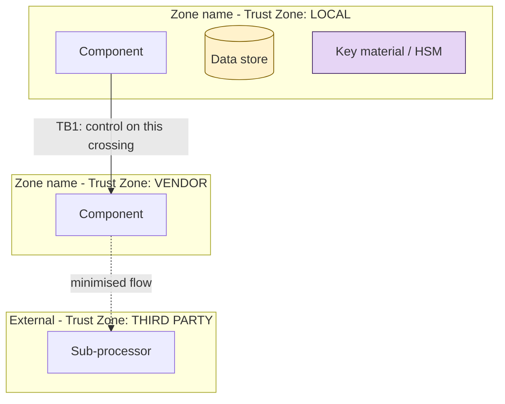
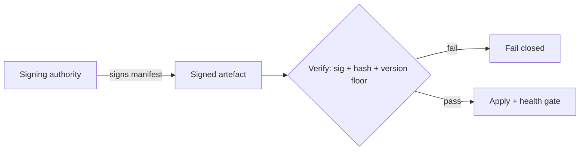
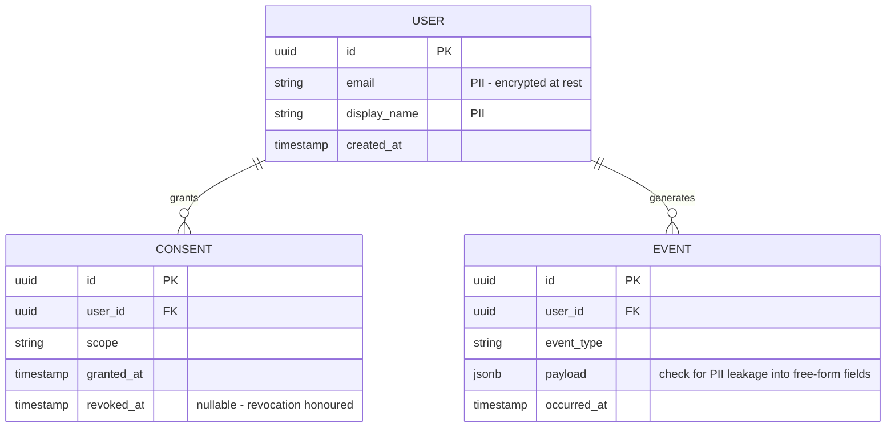
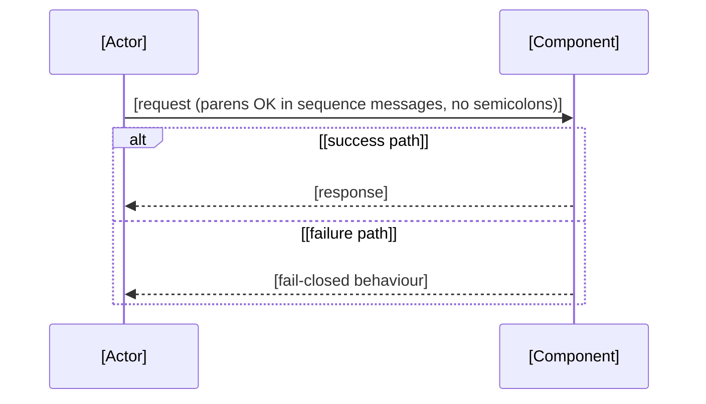

# [System Name] — Security Architecture, Gap Analysis & SRTM

<!-- SPDX-License-Identifier: Apache-2.0 -->
<!-- Copyright 2026 Brett Crawley -->

<!-- TEMPLATE. Replace every [placeholder]; delete all HTML comments before shipping.
     House style: references/house-style.md. This is the architecture + requirements half
     of a two-document pack; the STRIPED findings + risk register live in the companion
     threat model (see threat-model-template.md). -->

**Date:** [YYYY-MM-DD]
**Version:** [n.n] ([one-line change note, e.g. "first pass against the real architecture pack"])
**Prepared by:** **[Reviewer name, Title]** — author of this document. Produced with AI assistance ([model]) using the security-review skill set authored by **Brett Crawley, Principal Application Security Engineer**.
**Prepared for:** [Client contact (Client organisation)] <!-- external reviews only -->
**Frameworks:** [e.g. STRIDE/STRIPED · LINDDUN · OWASP Top 10 (2021) · Privacy by Design]
**Regulatory scope:** [applicable regulations, with conditionals stated — e.g. "EU CRA (conditional on EU sales)"]
**Companion document:** [`threat-model filename`] (STRIPED findings, worked examples, risk register)

> This document is the **architecture + requirements** half of the review. It [validates / reverse-validates] the design against [the inputs], classifies requirements, runs the use-case → abuse-case → security-use-case loop, and lands an SRTM. The **threat-model** half — detailed STRIPED findings with concrete examples and mitigations, plus the risk register — is the companion file.

---

## 0. Headline

[Open with credit: what is genuinely strong in this design, named specifically — the actual controls, not "good posture". A review that acknowledges what the team got right earns the standing to be blunt about what they didn't.]

What remains is a smaller, sharper set of issues. They cluster into [n] themes:

1. **[Theme, e.g. deployment lag on a known-critical fix].** [Two or three sentences: what, why it matters, issue ref. Where the team self-identified it, say you're agreeing.]
2. **[Theme].** [...]

There is also a small cluster of **residual design risks worth a decision** rather than a fix: [list them — deliberate capabilities or accepted primitives whose residual should be carried knowingly, in an ADR].

[Closing calibration line, e.g. "Nothing here is a reason not to launch; several are reasons not to launch *yet*."]

---

## 1. Assumptions & Context (validated against the inputs)

| Question | Answer from the inputs |
|---|---|
| What is being built | [One-paragraph system description: components, deployment, data flows] |
| Actors | [Data subjects, users, operators, autonomous components, sub-processors] |
| Data | [Data categories with sensitivity classification — flag special-category data and its treatment] |
| Deployment | [Where it runs; regions; deployment pipeline characteristics that matter to security] |
| Regulatory | [What applies now; what's conditional] |
| [Market / expansion triggers] | [e.g. EU sales would trigger CRA] |
| Downloadable/embedded software | [Yes/No — determines PSTI/CRA-style duties] |

**Assumptions I'm carrying (flag if wrong):** (a) [assumption]; (b) [assumption]; (c) [assumption].

---

## 2. Validated Architecture

### 2.1 System context (C4 L1) with trust zones



<!-- Render-safe rules (house style §5): no parentheses/semicolons/arrow glyphs/middle-dots
     in unquoted node or edge labels; quoted labels and subgraph titles are safer; avoid
     variation-selector emojis; classDef for consistent visual semantics. -->

### 2.2 Trust boundaries (canonical set)

| ID | Boundary | Crossing | Primary control | Confidence |
|----|----------|----------|-----------------|-----------|
| **TB1** | [A → B] | [What crosses] | [Named control] | [Strong / qualified — cite the open issue where the control isn't proven yet] |
| **TB2** | [...] | [...] | [...] | [...] |

### 2.3 [Highest-value trust chain, e.g. the software-update chain]



[One paragraph naming the **load-bearing property** this chain provides and the conditions under which it holds — plus the one or two things to watch.]

### 2.4 Data model & schemas

<!-- The data model is an EVALUATION INPUT, not just documentation: it is where PII is
     identified field by field and where encryption-at-rest claims are tested against
     reality. Request the schemas (DDL/migrations, ORM models, ERDs) up front — house
     style section 8. Every PII/special-category field found here must trace forward:
     to its protection status in the table below, to a P/LINDDUN finding in the
     companion threat model where protection is missing, and to a PRV/SEC requirement
     in the SRTM. Model the entities that carry sensitive data; you don't need every
     table. If working without schemas, say so in Assumptions and tag the privacy and
     encryption findings "if present". -->



<!-- Render-safe notes for erDiagram: attribute names must be single tokens (no spaces);
     comments go in the quoted string after the attribute; no parentheses in relationship
     labels. -->

**Per-store data classification, protection & retention:**

| Entity / store | Where it lives | Classification | Protection at rest | Retention | Deletion path |
|---|---|---|---|---|---|
| [USER] | [store, region] | [PII / special category / telemetry] | [field-level encryption / TDE / tokenised / plaintext — flag gaps in bold] | [period + basis] | [DSAR / scheduled hard-delete / **none — G-nn**] |
| [EVENT] | [...] | [...] | [...] | [...] | [...] |

**Schema-level concerns to check:** free-form fields (jsonb, text, logs) accumulating PII outside the classified columns; PII in indexes, backups, and replicas inheriting weaker controls; foreign keys that re-identify pseudonymised data when joined; schema migrations that copy sensitive columns without carrying their protections. Tie each gap found here to a **G-nn** and a **PRV/SEC requirement**.

### 2.5 [Highest-risk flow] sequence



---

## 3. Requirements Classification & Gap Analysis

Claims and design commitments, classified. Status reflects [the unified legend, or the client's own honesty legend where one exists]: 🔴 Open · 🟡 In progress · 🔵 Planned · 🟢 Live · ⚪ Accepted.

### 3.1 Functional (FR)

| ID | Requirement | Source | Status |
|----|-------------|--------|--------|
| FR-01 | [Requirement] | [Source doc/ADR] | [emoji] |

### 3.2 Security (SEC)

| ID | Requirement | Source | Status | Gap? |
|----|-------------|--------|--------|------|
| SEC-01 | [Requirement] | [Source] | [emoji] | [— or **G-nn**] |

### 3.3 Privacy (PRV)

| ID | Requirement | Source | Status | Gap? |
|----|-------------|--------|--------|------|
| PRV-01 | [Requirement] | [Source] | [emoji] | [— or **G-nn**; mark exemplary items "— (exemplary)"] |

### 3.4 Compliance (COMP)

| ID | Requirement | Source | Status | Gap? |
|----|-------------|--------|--------|------|
| COMP-01 | [Requirement] | [Source] | [emoji] | [— or **G-nn**] |

### 3.5 Consolidated gap list

| Gap | Title | Severity | Type |
|-----|-------|----------|------|
| **G-01** | [Title] | **[Severity]** | [Deploy lag / Assurance / Compliance / Doc-drift / Roadmap / Hardening / Design decision / Residual / Latent / Future] |

\* [Footnote conditional severities: the condition and the sequencing consequence.]

---

## 4. Use Cases → Abuse Cases → Security Use Cases

The core analytical loop. Each abuse case (the attacker succeeding) is paired with the security use case (the design decision that stops it). Focus on the boundaries where the interesting risk lives.

### UC-01 — [Use case title]

```
UC-01: [Short name]
Actor: [Who]
Goal: [What they achieve]
Preconditions: [What must hold]
Main flow:
  1. [Step]
  2. [Step]
Data: [What data, with classification]
Trust boundaries crossed: [TBn]
```

**SAC-01 — [Abuse case title].** *Attacker type:* [external/insider/legitimate-but-malicious]. *Flow:* [how the attack proceeds]. *Impact:* [consequence — name the human one].
**SUC-01 — [Countermeasure title].** [The design decision that stops it, with status. Name what to **add** where a gap exists, tied to a G-nn and a TA-nn.] *Residual:* [what remains after the control, and how it's mitigated or accepted]. `[OWASP ref]`

<!-- Privacy variants: PAC-nn (privacy abuse case: actor, scenario, PbD principle violated,
     regulatory exposure) paired with PUC-nn (privacy use case / countermeasure). Every
     abuse case links to a threat-model finding and at least one counter-use case. -->

### UC-02 — [...]
[...]

---

## 5. Refined Requirements (new, from the analysis)

New requirements this pass surfaced, to feed back into the requirements baseline (marked `[NEW]`, cross-referenced to their origin so provenance is traceable):

- **SEC-[nn]** `[NEW — from SAC-nn/SUC-nn]` [Requirement in one sentence].
- **PRV-[nn]** `[NEW — from PAC-nn/G-nn]` [Requirement].
- **COMP-[nn]** `[NEW — from G-nn]` [Requirement].

---

## 6. Security Requirements Traceability Matrix (SRTM)

| Req ID | Requirement (brief) | Type | Use Case | Threat / Abuse | Control (SUC/PUC) | Test ID | Priority |
|--------|---------------------|------|----------|----------------|-------------------|---------|----------|
| SEC-01 | [Brief] | SEC | UC-nn | SAC-nn | SUC-nn | TA-nn | Critical |
| PRV-01 | [Brief] | PRV | UC-nn | PAC-nn | PUC-nn | TA-nn | High |
| COMP-01 | [Brief] | COMP | UC-nn | [ref] | [ref] | TA-nn | High |

### 6.1 Test artifacts (selected)

- **TA-01 ([Type: Security Attack Test / Attack Test / Privacy Verification / Functional]) — [name].** [Scenario: what to attempt, from where]. *Expected:* [the pass condition, stated as observable behaviour]. *Tools:* [tools]. *Priority:* [Critical/High/Medium].
- **TA-02 (...) — [...].** [...]

---

## 7. Recommended sequence (what to do, in order)

**Before [gate] (launch gates):**
1. **[Action]** ([G-nn]) — *[flag the single most important item]*.
2. **[Action]** ([G-nn])

**Fast hygiene (days, cheap):**
3. [Action]. ([G-nn]/[req ID])

**Near-term:**
4. [Action]. ([G-nn])

**Decisions to ratify (not fixes):**
5. Accept or tighten [named residuals] explicitly, in an ADR, so they're carried knowingly.

---

## Appendix A — Privacy by Design scorecard

<!-- Include where privacy is a first-order concern. -->

| PbD principle | [System] posture |
|---|---|
| Proactive not reactive | [assessment] |
| Privacy as the default | [assessment] |
| Privacy embedded into design | [assessment] |
| Full functionality (positive-sum) | [assessment] |
| End-to-end security | [assessment — name the gaps in bold] |
| Visibility & transparency | [assessment] |
| Respect for user privacy | [assessment] |

---

*This document reflects [the inputs] as supplied ([date]); statuses tied to issue numbers are point-in-time. Nothing here is legal advice; [regulatory items] should be confirmed with counsel.*
